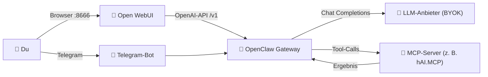
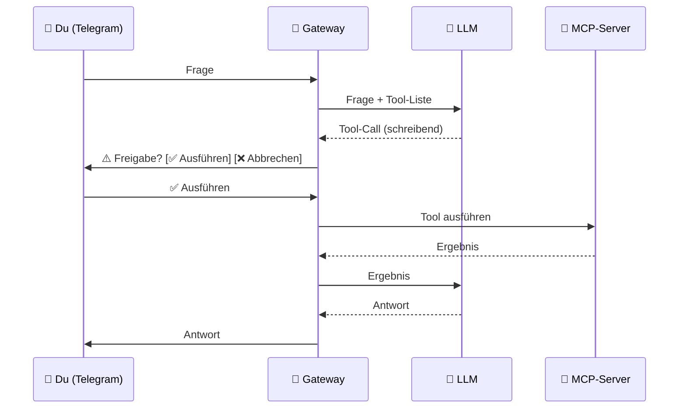

# hAI.OpenClawUIPortainer 🦾

[](https://github.com/jbkunama1/hAI.OpenClawUIPortainer)
[](https://github.com/jbkunama1/hAI.OpenClawUIPortainer)
[](https://github.com/jbkunama1/hAI.OpenClawUIPortainer)
[](https://github.com/open-webui/open-webui)
[](https://modelcontextprotocol.io)
[](https://nodejs.org)
[](https://core.telegram.org/bots/api)
[](LICENSE)

[](https://github.com/jbkunama1/hAI.OpenClawUIPortainer/actions/workflows/build.yml)
[](https://www.buymeacoffee.com/highfish)

> **Open WebUI + OpenAI-kompatibles Agent-Gateway mit MCP-Tools und Telegram-Kanal**  
> Self-hosted · Docker · Portainer · BYOK · MCP

---

## Features

- 💬 **Open WebUI** auf Port `8666` – komfortable Chat-Oberfläche im Browser
- 🔌 **Agent-Gateway** – OpenAI-kompatibles Backend (`/v1/chat/completions`) mit Streaming
- 🔑 **BYOK** – OpenAI, OpenRouter, Ollama oder jeder andere OpenAI-kompatible Anbieter
- 🧰 **MCP-Client** – Streamable HTTP mit SSE-Fallback, stdio, Auto-Reconnect, `tools/list_changed`
- 🤖 **Tool-Calling-Schleife** – bis zu 8 Runden, Allowlist, Ergebnis-Limit, Fehler gehen ans Modell zurück
- 📱 **Telegram** – Ein- und Ausgabekanal mit bunten Inline-Buttons
- ✅ **Freigabe-Buttons** – schreibende Tools laufen erst nach „Ausführen“
- 🐳 **GHCR-Image** per GitHub Actions, persistente Volumes, externes Netz `highfishNetwork`

---

## Architektur



### Freigabe schreibender Tools (Telegram)



---

## Schnellstart (Portainer)

1. Netzwerk anlegen (falls nicht vorhanden): `docker network create highfishNetwork`
2. **Portainer** → **Stacks** → **Add stack** → Name `openclaw`
3. **Repository** wählen:

   ```text
   https://github.com/jbkunama1/hAI.OpenClawUIPortainer.git
   ```

4. Branch `main`, Compose-Datei `docker-compose.yml`
5. **Environment variables** setzen (mindestens `GATEWAY_TOKEN`, `LLM_BASE_URL`, `LLM_API_KEY`, `WEBUI_SECRET_KEY`)
6. **Deploy the stack**

Schlüssel und Token erzeugst du z. B. mit:

```bash
openssl rand -hex 32
```

Die WebUI ist danach erreichbar unter **http://SERVER-IP:8666**. Beim ersten Aufruf legst du den Admin-Account an.

---

## Telegram einrichten

1. Bei [@BotFather](https://t.me/BotFather) einen Bot erstellen und das Token kopieren.
2. In Portainer `TELEGRAM_BOT_TOKEN` und `TELEGRAM_MODEL` (Modellname deines Anbieters) setzen, Stack aktualisieren.
3. Dem Bot eine Nachricht schreiben – er antwortet im Einrichtungsmodus mit deiner Telegram-ID.
4. ID in `TELEGRAM_ALLOWED_USERS` eintragen, Stack neu starten. Erst jetzt nutzt der Bot Agent und Tools.

| Button | Farbe | Funktion |
|---|---|---|
| 📊 Status | 🔵 blau | Version, verbundene MCP-Server, aktive Tools |
| 🛠 Tools | 🔵 blau | Tool-Liste, ⚠️ markiert Tools mit Freigabe |
| 🆕 Neuer Chat | 🟢 grün | Verlauf leeren |
| ❓ Hilfe | 🔵 blau | Befehle und Hinweise |
| ✅ Ausführen | 🟢 grün | Tool nach Rückfrage freigeben |
| ❌ Abbrechen | 🔴 rot | Tool ablehnen |

> 💡 Farbige Buttons nutzen das Feld `style` der Telegram Bot API (seit 9. Februar 2026). Ältere Telegram-Apps zeigen sie ohne Farbe.

Push-Nachrichten an Telegram sendest du über `POST /api/telegram/notify` (siehe Endpunkte) – die Basis für spätere Scheduler und Automationen.

---

## Environment-Variablen

### Pflicht

| Variable | Beispiel |
|---|---|
| `GATEWAY_TOKEN` | langes zufälliges Token |
| `LLM_BASE_URL` | `https://api.openai.com/v1` |
| `LLM_API_KEY` | API-Key des Anbieters |
| `WEBUI_SECRET_KEY` | Ausgabe von `openssl rand -hex 32` |

### Optional

| Variable | Standard | Beschreibung |
|---|---|---|
| `WEBUI_PORT` | `8666` | Externer Port der WebUI |
| `WEBUI_AUTH` | `true` | Login der WebUI |
| `WEBUI_NAME` | `OpenClaw Lab` | Anzeigename |
| `CORS_ALLOW_ORIGIN` | `*` | Erlaubte Origins, mit `;` trennen |
| `TZ` | `Europe/Berlin` | Zeitzone |

### MCP und Agent

| Variable | Standard | Beschreibung |
|---|---|---|
| `MCP_SERVERS_JSON` | `[]` | MCP-Server als JSON-Array |
| `HAI_MCP_TOKEN` | leer | Token für `${HAI_MCP_TOKEN}` in Headern |
| `AGENT_ENABLED` | `true` | Agent-Schleife an/aus |
| `AGENT_MAX_STEPS` | `8` | Maximale Tool-Runden pro Anfrage |
| `MCP_TOOL_ALLOW` | leer | Allowlist, leer = alle Tools |
| `MCP_TOOL_CONFIRM` | leer | Tools mit Freigabe in Telegram, leer = eingebaute Liste, `none` = aus |
| `SHOW_TOOL_CALLS` | `true` | Tool-Zeilen im Open-WebUI-Chat |

### Telegram

| Variable | Standard | Beschreibung |
|---|---|---|
| `TELEGRAM_BOT_TOKEN` | leer | Token von @BotFather |
| `TELEGRAM_ALLOWED_USERS` | leer | Erlaubte IDs/Usernames, leer = nur Einrichtungsmodus |
| `TELEGRAM_MODEL` | leer | Modellname für Telegram-Chats |
| `TELEGRAM_APPROVAL_TIMEOUT_S` | `120` | Sekunden bis eine Freigabe verfällt |
| `TELEGRAM_DEBUG` | `false` | Debug-Logs |

---

## BYOK-Beispiele

```text
# OpenAI
LLM_BASE_URL=https://api.openai.com/v1
LLM_API_KEY=sk-...

# OpenRouter
LLM_BASE_URL=https://openrouter.ai/api/v1
LLM_API_KEY=sk-or-v1-...

# Ollama im selben Docker-Netzwerk
LLM_BASE_URL=http://ollama:11434/v1
LLM_API_KEY=ollama
```

---

## MCP-Konfiguration

Echte URLs und Tokens gehören **nur** in die Portainer-Environment, nie ins Repository.

```json
[
  {
    "name": "hai",
    "transport": "http",
    "url": "https://mcp.example.com/mcp",
    "headers": { "Authorization": "Bearer ${HAI_MCP_TOKEN}" }
  }
]
```

| Feld | Bedeutung |
|---|---|
| `name` | Servername, Präfix der Tools (`name__tool`) |
| `transport` | `http` (Standard, mit SSE-Fallback), `sse` oder `stdio` |
| `url` | Endpunkt bei `http`/`sse` |
| `headers` | Zusätzliche Header, `${VAR}` wird aus der Container-Umgebung ersetzt |
| `command`, `args`, `env` | nur bei `stdio` |
| `enabled` | `false` deaktiviert den Server |

Einzeilig als Variable:

```text
MCP_SERVERS_JSON=[{"name":"hai","transport":"http","url":"https://mcp.example.com/mcp","headers":{"Authorization":"Bearer ${HAI_MCP_TOKEN}"}}]
```

---

## Gateway-Endpunkte

Alle außer `/health` verlangen `Authorization: Bearer <GATEWAY_TOKEN>`.

| Endpunkt | Zweck |
|---|---|
| `GET /health` | Status, `mcpConnected`, `agentTools`, `telegramBot` |
| `GET /v1/models` | Modelle des Anbieters |
| `POST /v1/chat/completions` | Chat mit Agent-Schleife (Header `x-agent: off` umgeht sie) |
| `GET /api/mcp/servers` | Verbindungsstatus je MCP-Server |
| `GET /api/mcp/tools` | Tools im OpenAI-Format |
| `POST /api/mcp/call` | Einzelnes Tool testen |
| `POST /api/telegram/notify` | Nachricht mit optionalen Buttons an Telegram senden |

---

## Repository-Struktur

```text
.
├── .github/workflows/build.yml   # Build & Push nach GHCR
├── src/
│   ├── index.js                  # Express-Gateway, Endpunkte
│   ├── mcp.js                    # MCP-Client-Manager
│   ├── agent.js                  # Tool-Calling-Schleife, Allowlist, Freigabe
│   └── telegram.js               # Telegram-Bot
├── docker-compose.yml            # Portainer-Stack
├── Dockerfile
├── .env.example
├── index.html                    # Projektseite (GitHub Pages)
├── LICENSE
└── README.md
```

---

## Sicherheit

- 🔐 Niemals echte API-Keys, Tokens oder MCP-URLs ins Repository committen.
- 🔑 `GATEWAY_TOKEN` und `WEBUI_SECRET_KEY` durch eigene Zufallswerte ersetzen.
- 👤 `TELEGRAM_ALLOWED_USERS` setzen, sonst bleibt der Bot im Einrichtungsmodus.
- ✅ Freigabe nur in Telegram: In Open WebUI laufen alle erlaubten Tools direkt. `MCP_TOOL_ALLOW` begrenzt sie dort.
- 🧱 Backend-Port `3000` nicht nach außen freigeben.
- 🌐 Für Internetzugriff HTTPS, Cloudflare Access oder Ähnliches vorschalten.

---

## Troubleshooting

```bash
docker logs openclaw
docker logs open-webui
```

| Symptom | Ursache / Lösung |
|---|---|
| Deploy bricht mit „WEBUI_SECRET_KEY setzen“ ab | Variable in Portainer ergänzen |
| `401` | `GATEWAY_TOKEN` prüfen |
| `502` | Backend-Container und `LLM_BASE_URL` prüfen |
| Image-Pull-Fehler | GHCR-Workflow und Paket-Sichtbarkeit prüfen |
| `mcpConnected: 0` | `GET /api/mcp/servers` zeigt Status und Fehlertext |
| Telegram antwortet nur mit ID | `TELEGRAM_ALLOWED_USERS` setzen |
| Telegram: „TELEGRAM_MODEL ist nicht gesetzt“ | Modellname eintragen |
| Telegram-Konflikt (409) | Es pollt nur eine Instanz pro Bot-Token |

---

## Roadmap

- [x] Open WebUI + Gateway im Portainer-Stack
- [x] MCP-Client und Tool-Calling-Schleife
- [x] Telegram als Ein- und Ausgabekanal mit Freigabe-Buttons
- [ ] Agentenprofile
- [ ] Scheduler
- [ ] Weitere Ausgabekanäle (E-Mail)

---

## Lizenz

MIT – siehe [LICENSE](LICENSE)

---

*Built with ❤️ in Karlsruhe*
